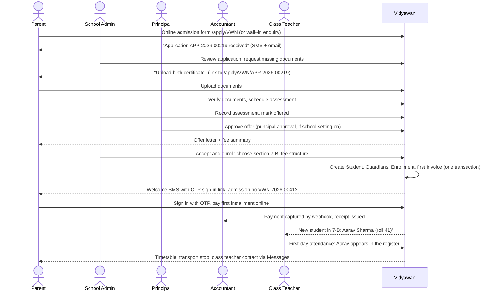
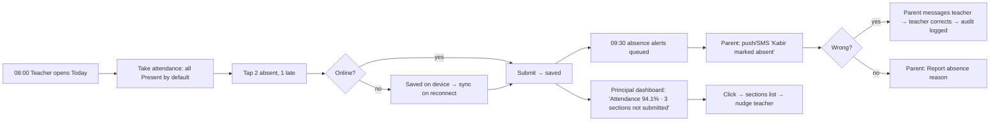
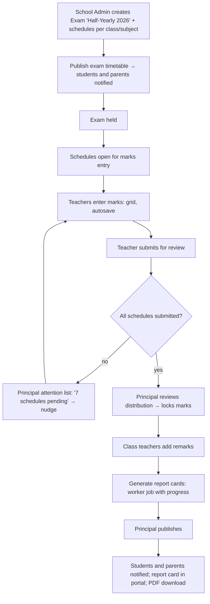
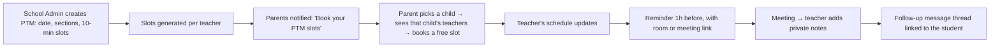
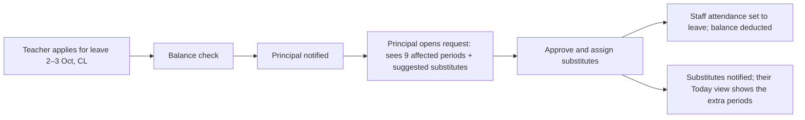
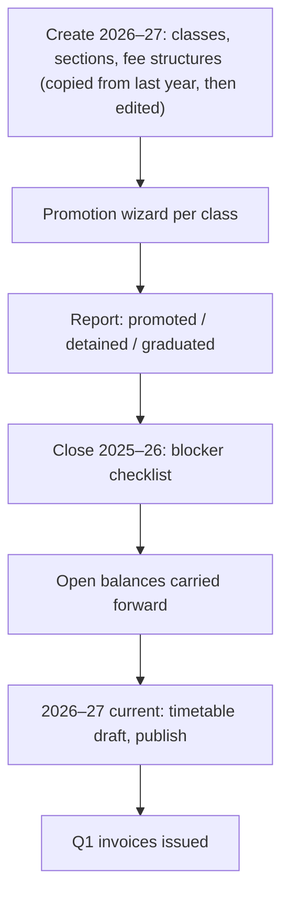

# 04 · User Journeys

End-to-end flows per persona, across screens and roles. Each journey lists its steps, the screen used ([10-screen-specs.md](10-screen-specs.md)), the moments that matter for UX, and what can go wrong. Personas: [02-personas-and-roles.md](02-personas-and-roles.md). Requirements: [03-prd.md](03-prd.md).

## J1 · Admission → enrollment → first day

**Actors:** parent (Sunita), school_admin (Meena), principal (Dr. Rao), accountant (Ramesh), teacher (Priya).



| Step | Screen | UX moment that matters | Failure and recovery |
|---|---|---|---|
| Apply | Public admission form (Wizard, 4 steps, autosave to a resumable link) | Mobile-first; ≤ 20 fields; Hindi available | Upload fails on poor network → retry per file, and the rest of the form is kept |
| Document chase | Admission detail → Documents | Checklist shows "2 of 5 verified"; one click sends a "request missing" message | The parent never uploads → a reminder after 3 days, and the school admin sees "Waiting on family" |
| Accept and enroll | Accept wizard | Shows section strength vs. capacity; fee structure pre-selected | Section full → warning, with the others suggested; a school admin can override with a reason |
| First payment | Parent Fees → Checkout | One "Pay now" | The gateway fails → a clear retry; the webhook reconciles late captures |
| First day | Teacher attendance | The new student is already in the list, sorted by roll number | Wrong section → a school_admin section transfer moves the student and their history |

## J2 · Daily attendance (teacher → parent → principal)



| Metric | Target |
|---|---|
| Teacher time from opening the app to submit (40 students, 3 exceptions) | ≤ 60 s |
| Taps | 1 (open) + 3 (exceptions) + 1 (submit) = 5 |

## J3 · Exam → marks → report card



UX moments: marks entry never loses data (autosave per cell); the teacher sees the progress "32 of 40 entered"; the principal sees a histogram before locking; publishing is a single confirmed action; parents get one notification per child, not one per subject.

## J4 · Fee invoice → payment → receipt → reconciliation

```mermaid
sequenceDiagram
  participant W as Worker
  participant V as Vidyawan
  actor P as Parent
  participant R as Razorpay
  actor Ac as Accountant
  W->>V: 1 Apr: issue Q1 invoices from fee structures (discounts applied)
  V-->>P: "Q1 fees ₹12,500 due 10 Apr" (push/SMS/email)
  P->>V: Fees → Pay now
  V->>R: Create order (idempotent per invoice set)
  P->>R: Pay via UPI
  R-->>V: Webhook payment.captured (signed)
  V->>V: Verify signature, create Payment, allocate, assign receipt no
  V-->>P: "Payment received. Receipt RCPT/2026-27/000902"
  W->>V: 11 Apr: mark unpaid invoices overdue, add late fee after grace
  V-->>P: Reminder (max 1 per 72h, quiet hours respected)
  W->>R: Daily settlement fetch
  W->>V: Match settlements ↔ payments; flag mismatches
  Ac->>V: Reconciliation view: 0 mismatches ✓
```

Counter variant: the accountant searches the student → oldest dues are preselected → the method → Collect → the receipt prints (≤ 30 s).

## J5 · Parent–teacher meeting



## J6 · Staff leave → substitution



## J7 · Library loan

1. The librarian focuses the Circulation scan input (the page opens with focus there).
2. Scan the member ID card → the member panel shows the photo, class, current loans and fines.
3. Scan the book barcode → the loan is created and the due date is shown.
4. Return: scan the book → the loan closes, and a fine is calculated if late. "Collect fine" hands off to the fee counter or the parent pays online.
5. Overdue: a daily job notifies members 1 day before and on the due date. The librarian's dashboard lists overdue loans with "Send reminders".

## J8 · Transport assignment and delay notice

1. A parent requests transport (Fees → Transport → "Request transport", picking a stop on the list, or on a map in v2).
2. The transport manager sees the request with the nearest routes and their capacity ("Route 4: 38 of 40").
3. Assign → a `TransportAssignment` is created → the transport fee line is added to the next invoice (pro-rated from the start date).
4. On a delay: Routes → Route 4 → "Notify route" → template "Bus on Route 4 is running about 20 minutes late" → sent to the guardians on that route (this bypasses quiet hours only if it is before 09:00 or after 13:00, the school's transport windows).

## J9 · Year-end rollover



## J10 · Student's day (self-service)

1. 07:30 push: "Today: 7 periods. Homework due: Maths worksheet 4."
2. Open Today → timetable (the current period highlighted), due homework and announcements.
3. After school: Homework → Submit → take a photo → submit → "Submitted to Ms. Nair at 17:42."
4. On results day: a notification → Results → report card → download PDF.

## J11 · Super Admin onboards a school

1. Create the organization → create the school (code `VWN`, board, timezone, locales).
2. Invite the school_admin (email + SMS).
3. Import wizard: students + guardians XLSX → dry run → fix → import; staff; opening fee balances.
4. School admin tutorial panel: academic year → classes and sections → subjects → period definitions → timetable → fee structures → invite teachers.
5. Go-live checklist on the Super Admin dashboard: "Attendance taken for the first time", "First online payment". Target: ≤ 1 working day ([01-product-vision.md](01-product-vision.md#success-metrics)).
