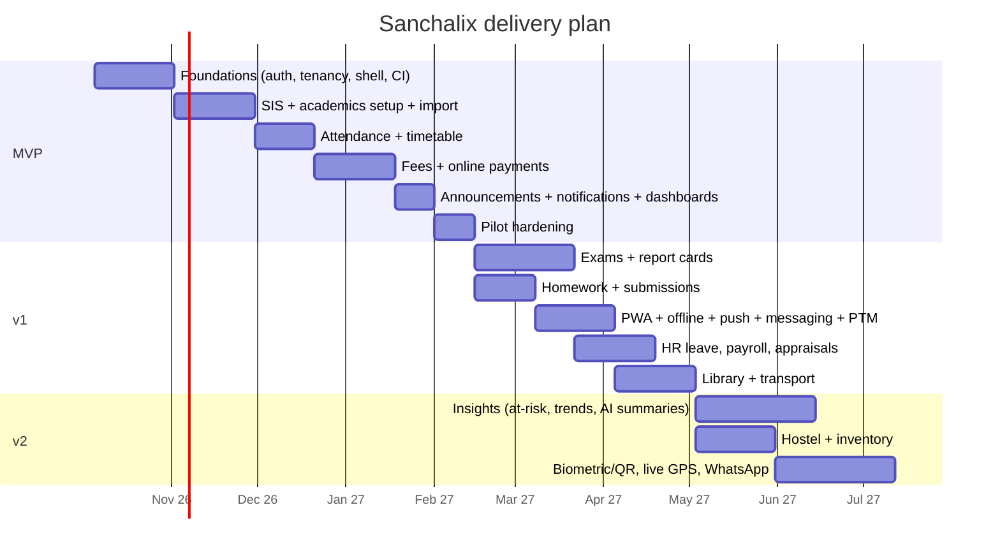

# 05 · Roadmap

Phased delivery from MVP to v2. Every feature's phase matches its row in [03-prd.md](03-prd.md). Dates assume a team of 1 PM, 1 designer, 4 full-stack engineers and 1 QA, starting **5 Oct 2026**. Each phase ends only when its exit criteria are met, not when its date arrives.

## MVP: "Run the school day" (Oct 2026 → Feb 2027, about 19 weeks)

**Outcome:** A pilot school (1 branch, about 800 students) runs daily attendance, fees and announcements entirely in Sanchalix.

| Area | Scope |
|---|---|
| Platform | Auth (password, OTP, Google), 2FA, 9 roles + scopes, tenant plugin, audit log, the AppLayout shell, icon map, en (hi before the pilot go-live, ADR-018), light/dark, density |
| SIS | Admissions pipeline, student and guardian records, documents, import, promotion, section transfer, TC |
| Staff | Directory, manual and QR staff attendance, leave apply/approve |
| Academics | Academic years, classes, sections, subjects, period definitions, the manual timetable editor with clash checks |
| Attendance | Daily + period attendance, absence alerts, register, corrections |
| Homework | Create and view (no online submissions yet) |
| Fees | Fee heads, structures, invoices, discounts, counter, Razorpay, receipts, late fees, dues + reminders, reconciliation, finance reports |
| Communication | Announcements, notices with acknowledgement, the notification centre, email/SMS/in-app channels, quiet hours |
| Calendar | Events, holidays, the year-close wizard |
| Insights | Role dashboards (all 9), attention lists, standard reports, CSV/XLSX export |

**Milestones**
- **M0 (30 Oct):** Walking skeleton: sign in → dashboard shell → a student list from seeded data, deployed to staging through CI.
- **M1 (27 Nov):** Onboarding: a real school's data imported into staging.
- **M2 (18 Dec):** Attendance usable end-to-end, with absence alerts.
- **M3 (15 Jan):** Fees: counter + online payment in Razorpay test mode.
- **M4 (5 Feb):** Pilot go-live.

**Exit criteria:** attendance ≤ 60 s median; counter payment ≤ 30 s median; 0 critical/serious axe issues; p75 LCP ≤ 2.5 s on the parent home; zero cross-tenant access in the pen test; restore drill passed; SUS ≥ 75 in pilot testing with 5 teachers and 5 parents.

## v1: "The whole academic cycle" (Feb → Jul 2027)

**Outcome:** 20 schools. Exam season (Sept half-yearlies) runs on Sanchalix, and parents use the PWA daily.

| Area | Scope |
|---|---|
| Exams | Grading schemes, exams and schedules, marks entry grid, moderation/lock, report cards (bulk PDF), rank (opt-in) |
| Homework | Submissions (camera), graded assignments, evaluation, reminders |
| PWA | Install, web push, offline attendance, offline Today view |
| Communication | Parent ↔ teacher messaging, office hours, PTM, emergency broadcast |
| HR | Salary structures, payroll runs, payslips, bank export, appraisals, substitution suggestions |
| Academics | Timetable auto-generation, substitutions, curriculum, lesson plans |
| Library | Catalogue, circulation with barcode, fines |
| Transport | Vehicles, routes, stops, assignments, transport fees, "Notify route", document expiry alerts |
| SIS | Online admission form, certificates, ID cards, "View as" and break-glass, data subject requests |
| Fees | Scholarships, refunds, reminder schedule, Tally export |

**Milestones:** v1.0 (exams + homework) by 30 Apr · v1.1 (PWA + messaging + PTM) by 31 May · v1.2 (HR + library + transport) by 15 Jul.
**Exit criteria:** 20 schools live; parent WAU ≥ 70%; report cards published within 7 days of the last exam at every school; the peak-load test passes at 25k concurrent users ([19-performance-and-scalability.md](19-performance-and-scalability.md#load-targets)).

## v2: "Insight and operations" (Aug → Dec 2027)

| Area | Scope |
|---|---|
| Insights | Rule-based at-risk scores with explanations, performance trends, opt-in LLM narrative summaries, AI draft remarks |
| Operations | Hostel (rooms, allocation, roll call, outpass), inventory (stock, reorder, purchase requests) |
| Attendance | Biometric devices, QR kiosks, bus boarding |
| Transport | Live GPS and ETA |
| Communication | WhatsApp Business channel |
| Platform | Custom roles, SAML/OIDC SSO, passkeys, per-school sandbox restore, Stripe, more languages (mr, ta, te, kn, bn), transcripts, hall tickets |

**Exit criteria:** insight precision validated with 3 schools (≥ 70% of flagged students confirmed as needing support by teachers); no PII in any LLM request (verified by a logging audit); 100 schools live.

## Explicitly later or never
- Native mobile apps: revisit if iOS push reach is < 60% of iOS parents by the end of v2.
- LMS, online exams, a custom report builder, plagiarism checks, a chatbot. See the non-goals in [01-product-vision.md](01-product-vision.md#non-goals).

## Risks and mitigations

| Risk | Impact | Mitigation |
|---|---|---|
| Teachers resist changing from paper | Adoption fails | Attendance ≤ 60 s; a pilot with teacher champions; in-app tutorial; offline mode in v1 |
| SMS DLT template approval delays | No absence alerts at go-live | Register templates in week 2; the email + in-app fallback is ready |
| Gateway onboarding (Razorpay KYC per school) takes weeks | No online fees at go-live | Start KYC at contract signature; the counter works without a gateway |
| Data quality in legacy imports | Wrong records on day one | A dry-run import with row-level errors; a school sign-off step |
| Exam season load spike | Slow marks entry | Load test before v1.0; autoscaling; marks writes are single small documents |
| Scope creep from pilot schools | MVP slips | This roadmap + MoSCoW; new asks go to the v1/v2 backlog by default |
