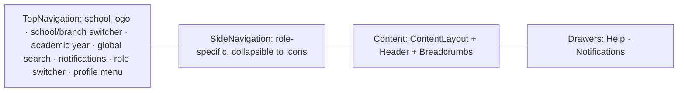

# 07 · Information Architecture

How Sanchalix is organised: the sitemap, the navigation each role sees, and the URL structure. Icons are the keys from [09-iconography.md](09-iconography.md#5-complete-icon-map). Permissions come from [02-personas-and-roles.md](02-personas-and-roles.md#rbac-matrix). Screen details are in [10-screen-specs.md](10-screen-specs.md).

## Principles

1. **Navigate by task, not by database table.** A teacher sees "Attendance", "Homework" and "Marks entry", not "Records".
2. **The role decides the nav, not the URL.** Every role uses the same URL for the same resource (`/students/abc`). What changes is the navigation, the actions and the fields shown. Links can be shared across roles, and access is decided by permission ([ADR-011](23-decision-log.md#adr-011-role-driven-navigation-with-shared-urls)).
3. **No more than 9 top-level items per role.** The rest goes into sections or tabs.
4. **Every screen is reachable in 3 clicks or fewer** from the dashboard, and every frequent daily task in 1 click (a dashboard primary action).
5. **The URL holds state.** Filters, sort, pagination, tabs and the selected student are in the query string, so the back button, refresh and sharing all work.

## Global shell

| Region | Cloudscape component | Contents |
|---|---|---|
| Top bar | `TopNavigation` | Identity (the school logo, linking to the dashboard); the `school` switcher (Super Admin and multi-school users only); the `academicYear` selector; global search; `notifications` (with an unread badge); `switchRole` (multi-role users only); the `profile` menu (My profile, Appearance, Density, Language, Keyboard shortcuts, Contact support, Sign out) |
| Left nav | `SideNavigation` inside `AppLayout` | Role nav (below), collapsible to the icon-only state; the active item uses the Filled weight |
| Breadcrumbs | `BreadcrumbGroup` | Always starts at "Dashboard" |
| Drawers | `AppLayout` drawers | Help (contextual per page), Notifications |
| Flash | `Flashbar` in `AppLayout.notifications` | Global success and error messages |
| Mobile | The same `AppLayout` (nav in an overlay), plus a bottom tab bar for `student` and `parent` in the PWA | See [08-design-system.md](08-design-system.md#8-responsive-and-pwa) |

## Sitemap

```mermaid
flowchart TD
  Root[Dashboard] --> SIS[Students]
  SIS --> SIS1[All students] & SIS2[Admissions] & SIS3[Promotions] & SIS4[Certificates] & SIS5[Alumni]
  Root --> STF[Staff]
  STF --> STF1[Directory] & STF2[Staff attendance] & STF3[Leave] & STF4[Payroll] & STF5[Appraisals]
  Root --> ACA[Academics]
  ACA --> ACA1[Classes and sections] & ACA2[Subjects and curriculum] & ACA3[Lesson plans] & ACA4[Timetable] & ACA5[Substitutions]
  Root --> ATT[Attendance]
  ATT --> ATT1[Take attendance] & ATT2[Attendance register] & ATT3[Leave requests]
  Root --> EXM[Exams]
  EXM --> EXM1[Exams and schedules] & EXM2[Marks entry] & EXM3[Grading schemes] & EXM4[Report cards]
  Root --> HW[Homework]
  Root --> FEE[Fees]
  FEE --> FEE1[Fee counter] & FEE2[Invoices] & FEE3[Payments and receipts] & FEE4[Dues] & FEE5[Fee structures] & FEE6[Concessions and scholarships] & FEE7[Reports]
  Root --> COM[Communication]
  COM --> COM1[Announcements] & COM2[Messages] & COM3[PTM]
  Root --> OPS[Operations]
  OPS --> LIB[Library] & TRN[Transport] & HST[Hostel] & INV[Inventory]
  Root --> CAL[Calendar]
  Root --> RPT[Reports and insights]
  Root --> SET[Settings]
  SET --> SET1[School profile] & SET2[Branches] & SET3[Academic years] & SET4[Users and roles] & SET5[Notifications] & SET6[Integrations] & SET7[Data import and export] & SET8[Audit log]
```

## Navigation per role

Items show the icon key in brackets. Items marked *(v1)* or *(v2)* are hidden until that release ([05-roadmap.md](05-roadmap.md)). A module a school has switched off in Settings is also hidden.

### super_admin

Built so far (under `/platform`): Platform overview, Schools and Platform audit log. The rest of this list is not built.

1. Dashboard [`dashboard`]
2. Organizations [`organization`]
3. Schools [`school`]
4. Onboarding and imports [`import`]
5. Platform users [`users`]
6. Platform notices [`announcements`]
7. Backups [`backups`]
8. Platform audit log [`auditLog`]
9. Settings [`settings`]

### school_admin
1. Dashboard [`dashboard`]
2. Students [`students`]: All students · Admissions · Promotions · Certificates · Alumni
3. Staff [`staff`]: Directory · Staff attendance · Leave · Payroll *(v1)* · Appraisals *(v1)*
4. Academics [`academics`]: Classes and sections · Subjects and curriculum · Timetable · Substitutions
5. Attendance [`attendance`]: Register · Leave requests
6. Exams [`exams`] *(v1)*: Exams and schedules · Grading schemes · Report cards
7. Communication [`announcements`]: Announcements · Messages · PTM *(v1)*
8. Operations [`inventory`]: Library *(v1)* · Transport *(v1)* · Hostel *(v2)* · Inventory *(v2)* · Calendar
9. Settings [`settings`]: School profile · Branches · Academic years · Users and roles · Notifications · Integrations · Data import and export · Audit log

Reports [`reports`] sits in the dashboard header as a secondary action, and in each module's header. This keeps the list to 9 items.

### principal
1. Dashboard [`dashboard`] (the "Needs your attention" list first)
2. Approvals [`roles`]: Leave · Scholarships · Refunds · Fee structures · Lesson plans · Marks lock (one queue, filterable by type)
3. Students [`students`]
4. Staff [`staff`]
5. Academics [`academics`]
6. Attendance [`attendance`]
7. Exams [`exams`] *(v1)*
8. Communication [`announcements`]
9. Reports and insights [`reports`] (Insights [`aiInsights`] *(v2)* is a tab)

### teacher
1. Today [`dashboard`]: my timetable, the attendance to take, the homework to check, marks due
2. Attendance [`attendance`] (defaults to the current period's section)
3. My classes [`classes`]: the sections I teach → students, timetable, performance
4. Homework [`homework`]
5. Marks entry [`marksEntry`] *(v1)*
6. Lesson plans [`lessonPlans`]
7. Messages [`messages`]
8. PTM [`ptm`] *(v1)*
9. My HR [`staff`]: leave, payslips *(v1)*, appraisal *(v1)*

Class teachers also get a "7-B (class teacher)" item inside "My classes" with report card remarks and leave requests.

### student (PWA bottom tabs on mobile)
1. Today [`dashboard`]: timetable, due homework, announcements
2. Homework [`homework`]
3. Results [`reportCard`] *(v1)*
4. Attendance [`attendance`]
5. More: Timetable [`timetable`] · Fees [`fees`] (read only) · Library [`library`] *(v1)* · Transport [`transport`] *(v1)* · Calendar [`calendar`] · Messages [`messages`] (if enabled) · Profile [`profile`]

### parent (PWA bottom tabs on mobile)
A child switcher [`students`] sits at the top of every page. It's hidden when the parent has only one child.
1. Home [`dashboard`]: today's attendance, dues, the next event, recent announcements
2. Fees [`fees`]: dues and "Pay now" · receipts
3. Attendance [`attendance`]: the calendar view, "Report absence"
4. Academics [`homework`]: homework · results *(v1)* · timetable
5. More: Messages [`messages`] · PTM [`ptm`] *(v1)* · Transport [`transport`] *(v1)* · Calendar [`calendar`] · Documents [`documents`] · Profile [`profile`]

### accountant
1. Dashboard [`dashboard`]: today's collection, pending reconciliation, dues ageing
2. Fee counter [`collectPayment`]
3. Invoices [`invoice`]
4. Payments and receipts [`receipt`]
5. Dues [`dues`]
6. Fee structures [`fees`]
7. Concessions and scholarships [`concession`]
8. Payroll [`payroll`] *(v1)*
9. Reports [`financeReports`]

### librarian
1. Dashboard [`dashboard`]
2. Circulation [`loans`]
3. Catalogue [`book`]
4. Overdue [`overdue`]
5. Members [`users`]
6. Reports [`reports`]

### transport_manager
1. Dashboard [`dashboard`]
2. Routes [`route`]
3. Vehicles [`vehicle`]
4. Stops [`stop`]
5. Assignments [`students`]
6. Live tracking [`liveTracking`] *(v2)*
7. Transport attendance [`attendance`] *(v2)*
8. Reports [`reports`]

## URL structure

Pattern: `/{locale}/{module}/{resource}/{id?}/{subview?}?{query}`

- `{locale}` is `en` or `hi` (next-intl). It's hidden for the default locale.
- Authenticated routes sit in the `(app)` route group. Sign-in, the public admission form and the receipt verification page sit in `(public)`.
- IDs are ObjectIds, except for the human-facing numbers used in public verification (`/verify/receipt/RCPT-2026-27-000871`).

| URL | Screen | Main roles |
|---|---|---|
| `/` | Role dashboard | all |
| `/signin`, `/signin/otp` | Sign in (password, Google, OTP) | all |
| `/apply/{schoolCode}` | Public online admission form | public |
| `/verify/receipt/{receiptNo}` | Receipt authenticity check (shows no PII) | public |
| `/students` | Student list | school_admin, principal, teacher |
| `/students/{id}` | Student profile (tabs: overview, attendance, academics, fees, documents, guardians, history) | school_admin, principal, teacher, parent (ward) |
| `/students/{id}?tab=fees` | Student profile, fees tab | same |
| `/admissions`, `/admissions/new`, `/admissions/{id}` | The admission pipeline and a single application | school_admin, principal |
| `/students/promotions` | The promotion wizard | school_admin |
| `/staff`, `/staff/{id}` | Staff directory and profile | school_admin, principal |
| `/staff/leave`, `/staff/payroll/{month}`, `/staff/appraisals` | HR | per matrix |
| `/academics/classes`, `/academics/sections/{id}` | Classes and a section overview | school_admin, teacher |
| `/academics/subjects/{id}` | Subject with curriculum | school_admin, teacher |
| `/academics/timetable?section={id}` or `?teacher={id}` | Timetable view and editor | all (view), school_admin (edit) |
| `/academics/lesson-plans` | Lesson plans | teacher, principal |
| `/attendance/take?section={id}&date={YYYY-MM-DD}&period={n}` | Take attendance | teacher |
| `/attendance/register?section={id}&month={YYYY-MM}` | The monthly register | school_admin, principal, teacher |
| `/exams`, `/exams/{id}` | Exams and schedules | school_admin, principal |
| `/exams/{id}/marks?class={id}&subject={id}&section={id}` | The marks entry grid | teacher |
| `/exams/report-cards?exam={id}&section={id}` | Report card generation and publishing | school_admin, principal |
| `/homework`, `/homework/{id}` | Homework list and detail (with submissions) | teacher, student, parent |
| `/fees/counter?student={id}` | Fee counter | accountant |
| `/fees/invoices`, `/fees/invoices/{id}` | Invoices | accountant, parent (own) |
| `/fees/payments`, `/fees/payments/{id}` | Payments and receipts | accountant |
| `/fees/dues` | Dues and reminders | accountant, principal |
| `/fees/pay?invoices={id,id}` | Parent checkout | parent |
| `/fees/structures`, `/fees/concessions` | Configuration | accountant |
| `/communication/announcements`, `/communication/announcements/new` | Announcements | per matrix |
| `/messages`, `/messages/{threadId}` | Inbox and thread | all except super_admin |
| `/ptm`, `/ptm/{eventId}` | PTM events and slot booking | school_admin, teacher, parent |
| `/library/circulation`, `/library/catalogue/{bookId}` | Library | librarian |
| `/transport/routes/{id}`, `/transport/vehicles/{id}` | Transport | transport_manager |
| `/hostel`, `/inventory` | Hostel and inventory | school_admin |
| `/calendar?view=month&date=YYYY-MM` | School calendar | all |
| `/reports/{reportKey}` | Report runner (filters → table → export) | per matrix |
| `/insights` | At-risk list (v2) | principal, teacher (assigned) |
| `/approvals?type=leave` | The approvals queue | principal |
| `/settings/{section}` | Settings | school_admin |
| `/settings/audit-log?entity=student:{id}` | Audit log | school_admin, principal |
| `/profile`, `/profile/security` | My profile, 2FA, sessions | all |
| `/notifications` | The full notification list | all |

### Query-string conventions
- Collections: `q` (free text), `filter` (a PropertyFilter token string), `sort=field:asc`, `cursor`, `pageSize` (10, 25, 50 or 100).
- Tabs: `tab=`.
- Dates: `date=YYYY-MM-DD`, `month=YYYY-MM`.
- Context: `section=`, `student=` and `exam=`, so deep links from notifications land on the exact view.

## Search

Global search (`TopNavigation` search, shortcut `/`) finds students (by name, admission number or guardian phone), staff (by name or employee number), invoices and receipts (by number) and pages ("fee counter"). Results are grouped by type and filtered by permission, and the top 5 per group appear in an `Autosuggest`. Enter opens the first result. See [10-screen-specs.md](10-screen-specs.md#global-search).

## Notification deep links

Every notification carries a `link` that opens the exact context, e.g. an absence alert → `/students/{id}?tab=attendance&month=2026-09`, and a fee reminder → `/fees/pay?invoices={id}`. A link to something the user can't access shows a 403 page with a "Go to dashboard" action, never a blank screen.
