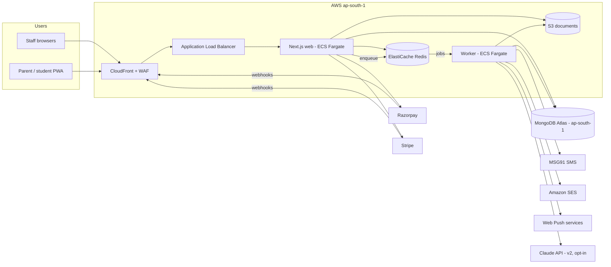
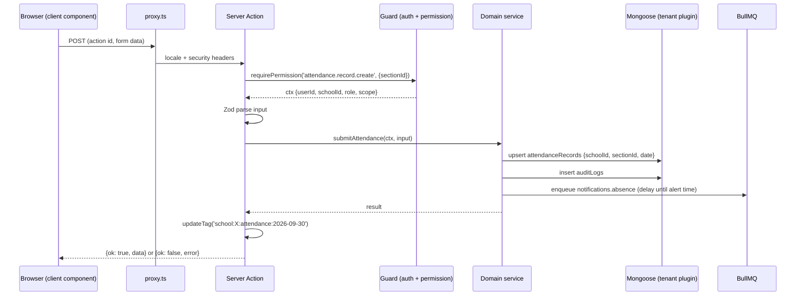

# 13 · Architecture

The system architecture for Vidyawan: its components, folder structure, rendering strategy, state management and the main runtime flows. Decisions and trade-offs are recorded in [23-decision-log.md](23-decision-log.md). Data: [14-data-model.md](14-data-model.md). APIs: [15-api-spec.md](15-api-spec.md). Security: [16-auth-and-security.md](16-auth-and-security.md). Operations: [20-devops-and-deployment.md](20-devops-and-deployment.md).

## Stack

| Layer | Choice |
|---|---|
| Web app | Next.js 16 (App Router, React Server Components, Server Actions, Route Handlers), TypeScript `strict` |
| UI | Cloudscape (`@cloudscape-design/*`) + Reicon via `src/components/icons.tsx` |
| i18n | `next-intl` + Cloudscape `I18nProvider`. English only for now ([ADR-018](23-decision-log.md#adr-018-english-only-until-the-core-modules-are-built)); Cloudscape ships no Hindi bundle, so its `hi` component strings will come from our own catalogue |
| Validation | Zod (shared by forms, actions and route handlers) |
| Database | MongoDB 8 (Atlas, replica set; transactions for multi-document writes) + Mongoose 9 |
| Queue and cache | Redis (ElastiCache) + BullMQ |
| Worker | A Node.js 22 process (`worker/`) consuming BullMQ queues |
| Files | Amazon S3 (private, SSE-KMS), presigned URLs; CloudFront for static assets |
| PDF | `@react-pdf/renderer` in the worker (receipts, report cards, TCs, payslips) |
| Auth | Database sessions written by `src/server/auth/session.ts` for password and OTP sign-in; Auth.js v5 for Google only ([ADR-017](23-decision-log.md#adr-017-password-sign-in-writes-sessions-directly-without-authjs)) |
| Payments | Razorpay (primary), Stripe (adapter) |
| Messaging | MSG91 (SMS), Amazon SES (email), Web Push (VAPID) |
| Observability | OpenTelemetry → CloudWatch / X-Ray; Sentry for errors; pino structured logs |

## System context



## Containers and responsibilities

| Container | Responsibilities | Scales on |
|---|---|---|
| **web** (Next.js) | SSR/RSC pages, Server Actions (UI mutations), Route Handlers (webhooks, exports, PWA sync, public verification), auth, authorization, validation, enqueueing jobs | CPU + request count; 2–20 tasks |
| **worker** | Notifications fan-out and delivery, PDF generation, imports, invoice generation, dues/late-fee jobs, reminders, reconciliation, timetable solver, risk scoring, scheduled jobs (BullMQ repeatable jobs) | Queue depth; 1–10 tasks |
| **MongoDB Atlas** | System of record | Vertical, then sharding by `schoolId` ([19-performance-and-scalability.md](19-performance-and-scalability.md#multi-tenancy-and-sharding)) |
| **Redis** | BullMQ queues, rate limits, short-lived cache, SSE fan-out (pub/sub) | Vertical |
| **S3** | Documents, photos, generated PDFs, import files, exports, archives | — |

The worker and the web app share `src/server/**` (models, domain services). The worker is not a microservice: it is the same codebase with a different entry point ([ADR-001](23-decision-log.md#adr-001-nextjs-monolith-plus-a-background-worker)).

## Folder structure

```
/
├─ CLAUDE.md
├─ Docs/                              # this documentation
├─ src/
│  ├─ app/
│  │  ├─ [locale]/
│  │  │  ├─ (public)/                 # signin, apply/[schoolCode], verify/receipt/[no]
│  │  │  ├─ (app)/                    # authenticated; layout.tsx renders the AppLayout shell
│  │  │  │  ├─ page.tsx               # role dashboard
│  │  │  │  ├─ students/…             # one folder per module (see the URL table in 07)
│  │  │  │  ├─ attendance/…
│  │  │  │  ├─ fees/…
│  │  │  │  └─ …
│  │  │  └─ layout.tsx                # rejects unknown locales
│  │  ├─ layout.tsx                   # html lang, global styles, providers
│  │  ├─ api/
│  │  │  ├─ auth/[...nextauth]/route.ts
│  │  │  ├─ webhooks/razorpay/route.ts
│  │  │  ├─ webhooks/stripe/route.ts
│  │  │  ├─ webhooks/msg91/route.ts
│  │  │  ├─ v1/…                      # REST for the PWA sync, exports, devices
│  │  │  └─ health/route.ts
│  │  ├─ manifest.ts                  # PWA manifest
│  │  └─ sw.ts                        # service worker (Serwist)
│  ├─ components/                     # shared UI built from Cloudscape only
│  │  ├─ icons.tsx                    # the ONLY reicon-react import site
│  │  ├─ AppShell.tsx
│  │  ├─ MobileTabBar.tsx
│  │  ├─ EmptyState.tsx
│  │  └─ StudentPicker.tsx
│  ├─ features/                       # UI per module: components + client hooks
│  │  ├─ attendance/
│  │  │  ├─ TakeAttendance.tsx
│  │  │  └─ useOfflineAttendance.ts
│  │  ├─ fees/
│  │  └─ …
│  ├─ server/                         # server-only code (import 'server-only')
│  │  ├─ db/                          # connection, tenantPlugin, transactions
│  │  ├─ models/                      # Mongoose models, 1 file per collection
│  │  ├─ auth/                        # Auth.js config, permissions.ts, guards
│  │  ├─ modules/                     # domain services per module
│  │  │  ├─ attendance/
│  │  │  │  ├─ actions.ts             # 'use server' Server Actions
│  │  │  │  ├─ service.ts             # business logic, no Next imports
│  │  │  │  ├─ queries.ts             # read functions used by RSC pages
│  │  │  │  └─ schemas.ts             # Zod
│  │  │  └─ …
│  │  ├─ jobs/                        # queue names, producers, job payload types
│  │  ├─ notifications/               # templates, channel adapters
│  │  ├─ payments/                    # razorpay.ts, stripe.ts behind PaymentGateway
│  │  ├─ files/                       # S3 presign, virus scan hook
│  │  └─ audit.ts
│  ├─ lib/                            # pure utilities (money, dates, contrast)
│  ├─ i18n/                           # next-intl config + messages/en.json
│  ├─ proxy.ts                        # Next.js 16 request proxy: locale, auth redirect, security headers
│  └─ styles/global.css               # .vw-icon, print styles only
├─ scripts/seed.ts                    # synthetic local data (npm run seed)
├─ worker/
│  ├─ index.ts                        # BullMQ workers registration
│  └─ processors/                     # one file per queue
└─ tests/
   ├─ e2e/                            # Playwright
   └─ fixtures/
```

Rules: `features/*` never imports from `server/modules/*/service.ts` directly; it calls Server Actions or receives props from RSC pages. `server/**` never imports from `features/**` or `components/**`. The whole layout is described in [17-coding-standards.md](17-coding-standards.md#file-and-folder-structure).

## Rendering strategy

| Page kind | Strategy | Why |
|---|---|---|
| Dashboards, lists, detail pages | **Dynamic RSC** (per-request, personalised, tenant-scoped). Data is fetched in server components through `server/modules/*/queries.ts`. `<Suspense>` streams each region. | Fresh, permission-filtered data; no client waterfalls; fast first paint on slow phones |
| Reference data (classes, subjects, fee heads, period definitions) | `'use cache'` with `cacheTag('school:{id}:classes')`, invalidated with `updateTag` on mutation | Read on every page, changes rarely |
| Interactive islands (marks grid, attendance, counter, composer) | Client components (`'use client'`), hydrated with initial data from RSC props | High-frequency interaction and local state |
| Public pages (sign in, apply, verify receipt) | Static shell + dynamic data where needed | Speed |
| PWA offline views | The service worker caches the shell + the last Today payload | Offline-first for the core tasks |

Cloudscape components are client components. RSC pages render them as leaves, passing serialisable props. Icons are passed as elements created with `svg()`, which works across the server/client boundary because Reicon icons are client components ([09-iconography.md](09-iconography.md#2-how-the-integration-works)).

## State management

A deliberately small toolset. There is no global client state library ([ADR-010](23-decision-log.md#adr-010-server-first-state-without-a-client-state-library)).

| State | Where it lives |
|---|---|
| Server data | RSC props. After a mutation, the Server Action calls `updateTag`/`revalidatePath`, and the page re-renders |
| URL state (filters, sort, cursor, tab, selected section and date) | Search params, read on the server; client updates via `router.replace` |
| Form state | Local `useState` / `useActionState`; Zod-validated on the client for instant feedback and again on the server |
| Optimistic UI | `useOptimistic` for attendance toggles, message sends and mark-as-read |
| Grid autosave | A per-cell debounced Server Action call with a local "pending/saved/error" map |
| Offline queue (PWA) | IndexedDB (via `idb-keyval`) with idempotency keys, flushed by `/api/v1/sync` |
| User preferences (mode, density, locale) | `User` document + a cookie mirror for first paint |
| Real-time counts (notifications) | SSE `/api/v1/events` backed by Redis pub/sub; fallback polling every 60 s |

## Request lifecycle (a Server Action)



## Background jobs

| Queue | Jobs | Trigger |
|---|---|---|
| `notifications` | `fanout` (announcement → per-user notifications), `deliver` (per channel), `digest` | Enqueued by actions; per-channel rate limits |
| `pdf` | `receipt`, `reportCard`, `tc`, `payslip`, `idCards` | Actions; bulk jobs split per student |
| `imports` | `validate`, `commit` | Import wizard |
| `fees` | `issueInvoices` (daily 02:00 IST), `markOverdue` + `lateFee` (daily 03:00), `reminders` (daily 10:00), `reconcile` (daily 06:00) | Repeatable |
| `attendance` | `absenceAlerts` (at the school's alert time), `monthlyRollup` | Delayed / repeatable |
| `timetable` | `generate` (constraint solver, ≤ 5 min) | Admin action |
| `insights` (v2) | `scoreSchool` (weekly Sunday 22:00), `summarise` (LLM, opt-in) | Repeatable |
| `maintenance` | `purgeExpiredPII`, `archiveOld`, `expiryAlerts` (vehicle docs) | Daily |

Every job is idempotent: jobs carry a deterministic `jobId` (e.g. `invoices:{schoolId}:{installmentId}`), and writes use unique indexes. Retries use exponential backoff (5 attempts); failed jobs go to a dead-letter list visible on the Super Admin dashboard.

## Multi-tenancy at runtime

1. `proxy.ts` resolves the session cookie → the user.
2. `getContext()` (in `server/auth`) loads the session, the active role and the active `schoolId`, cached per request with React `cache()`.
3. Every service takes `ctx` as its first argument and passes `ctx.schoolId` into queries. The tenant plugin rejects queries without `schoolId` ([14-data-model.md](14-data-model.md#tenant-plugin)).
4. S3 keys are prefixed with `schoolId`. The presign function checks the prefix matches `ctx.schoolId`.
5. Cache tags are prefixed with `school:{id}`.

## PWA

- **Serwist** service worker: precaches the app shell; runtime caching (NetworkFirst) for the Today and homework payloads; a background sync for the offline queue.
- Web push via VAPID. Subscriptions are stored per user and device. iOS needs the PWA installed (iOS 16.4+), so the install prompt explains this.
- The manifest has school-branded `short_name` and `icons` per school subdomain (v1: `{code}.vidyawan.app`).

## Key architectural qualities

| Quality | Target | How |
|---|---|---|
| Availability | 99.9% monthly (the school day, 07:00–18:00 IST, is the priority) | Multi-AZ ECS, Atlas replica set, health checks, rolling deploys |
| Latency | p95 server response < 300 ms for reads, < 500 ms for writes | Indexes, lean queries, RSC streaming ([19-performance-and-scalability.md](19-performance-and-scalability.md)) |
| Data durability | RPO ≤ 5 min, RTO ≤ 1 h | Atlas continuous backup (PITR) ([20-devops-and-deployment.md](20-devops-and-deployment.md#backups-and-disaster-recovery)) |
| Security | OWASP ASVS L2 | [16-auth-and-security.md](16-auth-and-security.md) |
| Residency | All personal data in India | ap-south-1 for everything; the LLM gets no PII |
