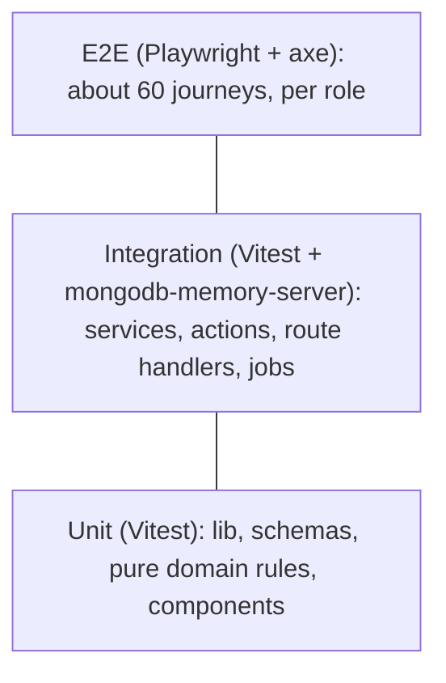

# 18 · Testing Strategy

How Vidyawan is tested: what each layer covers, which tools, the coverage goals and the CI gates. Conventions: [17-coding-standards.md](17-coding-standards.md#testing-conventions). Accessibility requirements: [11-accessibility.md](11-accessibility.md). Security requirements: [16-auth-and-security.md](16-auth-and-security.md).

## Test pyramid

| Layer | Tool | Scope | Speed target |
|---|---|---|---|
| Unit | Vitest | `src/lib/*` (money, dates, contrast, grading), Zod schemas, pure domain functions (fee calculation, attendance %, risk factors, timetable constraints), small client components (React Testing Library) | < 30 s total |
| Integration | Vitest + `mongodb-memory-server` (a replica set, for transactions) + `ioredis-mock` for BullMQ producers | Services with a real Mongo; Server Actions called directly with a fake `ctx`; route handlers via `next-test-api-route-handler`; worker processors | < 3 min |
| Contract | Vitest | Payment and SMS adapters against recorded provider fixtures; webhook signature verification with real sample payloads | < 30 s |
| E2E | Playwright (Chromium, WebKit, and Pixel 7 + iPhone 14 emulation) | The critical journeys ([04-user-journeys.md](04-user-journeys.md)) end-to-end against a seeded staging-like environment | < 12 min, sharded ×4 |
| Visual | Playwright screenshots | Key screens in light/dark × desktop/mobile × en/hi; icon rendering sanity | Reviewed on diff |
| Load | k6 | Attendance peak, the counter, report card generation | Pre-release |
| Security | CodeQL, ZAP, permission matrix tests | See below | Nightly / PR |

## What must be tested (non-negotiable)

| Area | Tests |
|---|---|
| **Tenancy** | For every model: a query without `schoolId` throws; school A's ID in school B's context returns `NOT_FOUND`. An auto-generated test iterates over all registered models. |
| **Permissions** | A matrix test generated from `permissions.ts` × every Server Action: each role either succeeds or gets `FORBIDDEN`, as expected from [02-personas-and-roles.md](02-personas-and-roles.md#rbac-matrix). Scope tests: a teacher can't take attendance for a section they don't teach; a parent can't read a non-ward student. |
| **Money** | Invoice totals (lines + GST − concessions + late fee); allocation oldest-first; partial payments; refunds; receipt numbers are gap-free and unique under 50 concurrent collections; double-submit with the same idempotency key → one payment; a webhook replayed 3× → one payment; a signature mismatch → rejected. |
| **Attendance** | Default Present; holiday blocking; future date rejected; the entries must match the enrollments; offline sync idempotency; the absence alert is not sent if corrected before the alert time; attendance % formula including `leaveCountsAsAbsent`. |
| **Exams** | Marks bounds; absent handling; the lock prevents edits; grade band lookup at the boundaries (32.99 / 33.00); report card snapshot immutability after publishing. |
| **Timetable** | Teacher and section clash detection; the solver respects constraints and reports unsatisfiable ones. |
| **Admissions** | The state machine allows only valid transitions; acceptance is atomic (a failure mid-way leaves no partial student). |
| **Notifications** | Quiet hours defer; the 72 h reminder dedupe; channel preferences respected; template rendering for every key × locale (no missing params). |
| **Imports** | Row-level errors; duplicate detection; dry run makes no writes. |
| **Icons** | Every key in `icons.tsx` maps to an existing Reicon export (the import compiles); a lint test confirms no `iconName` and no `reicon-react` import outside `icons.tsx`. |

## Accessibility tests

- `@axe-core/playwright` runs on **every page visited by E2E**, in light and dark mode, on desktop and mobile viewports. Any `critical` or `serious` violation fails the build.
- Keyboard E2E: for the attendance, marks entry, fee counter, admission wizard and announcement composer flows, a test completes the task **with the keyboard only** (no `click()` calls).
- Focus tests: after submit with errors, focus is on the first invalid field; after closing a modal, focus is back on the trigger.
- Manual screen reader and zoom checks per release ([11-accessibility.md](11-accessibility.md#testing)).

## Security tests

- The permission matrix and tenancy tests above run on every PR.
- CodeQL (JavaScript/TypeScript) on every PR; `npm audit --omit=dev --audit-level=high` blocks the merge.
- ZAP baseline scan against staging nightly; high findings open an issue automatically.
- Webhook tests: invalid signature → 400; replayed event → no side effects; out-of-order events (captured before authorised) → the correct final state.
- Rate limit tests for OTP and sign-in.
- A yearly external pen test (MVP pre-launch is mandatory).

## Coverage goals

Coverage is a floor, not a target. Critical domains get the highest bar.

| Area | Line coverage | Branch coverage |
|---|---|---|
| `server/modules/fees`, `server/auth`, `server/db` | ≥ 95% | ≥ 90% |
| Other `server/modules/*` | ≥ 85% | ≥ 75% |
| `lib/*` | ≥ 95% | ≥ 90% |
| `features/*` (client components) | ≥ 60% | — (E2E covers the interaction) |
| Overall | ≥ 80% | ≥ 70% |

CI fails if coverage in a critical area drops below its threshold.

## E2E journeys (the minimum set)

| # | Journey | Roles |
|---|---|---|
| 1 | OTP sign-in → child switcher → home | parent |
| 2 | 2FA setup on first sign-in | accountant |
| 3 | Admission enquiry → documents → accept and enroll → student visible in the section | school_admin |
| 4 | Take attendance with 2 absences → submit → the absence alert job is queued | teacher |
| 5 | Offline attendance → reconnect → synced once | teacher (PWA, offline emulation) |
| 6 | Counter payment → receipt PDF → dues updated | accountant |
| 7 | Parent online payment (Razorpay test mode) → webhook → receipt | parent |
| 8 | Marks entry with keyboard → submit → principal locks → report cards published → parent sees the result | teacher, principal, parent |
| 9 | Homework set → student submits a photo → teacher evaluates | teacher, student |
| 10 | Announcement to a section with SMS → the reach preview is correct | principal |
| 11 | Leave apply → approve with a substitute → the substitute's Today shows the period | teacher, principal |
| 12 | Library issue and return by scan | librarian |
| 13 | Permission denial: a teacher opens `/fees/counter` → 403 page | teacher |
| 14 | Language switch to Hindi → key screens render with no missing keys | parent |
| 15 | Year-end promotion → the new year is current | school_admin |

## Test data

- **Seed script** (`npm run seed`): 2 schools (to test isolation), 2 branches, 1,200 students, 80 staff, a full year of attendance, 2 exams, fee structures with every edge (siblings, scholarships, partial payments).
- Factories (`tests/fixtures/factories.ts`) build valid entities with overrides. No shared mutable fixtures.
- The data is synthetic (Faker `en_IN`). **Production data is never used in tests or staging.**

## Load tests (k6)

| Scenario | Profile | Pass criteria |
|---|---|---|
| Morning attendance peak | 5,000 teachers submit within 30 min (ramping), plus 20,000 parents opening the home | p95 < 500 ms for writes, < 300 ms for reads, error rate < 0.1% |
| Fee rush | 200 counters × 2 payments/min + 1,000 online checkouts/min | p95 < 800 ms, 0 duplicate receipts |
| Results day | 50,000 report card views in 1 h after publishing | p95 < 1 s (the PDF is served from S3 via a presigned URL) |
| Report card generation | 10,000 PDFs | Completes in ≤ 20 min with 4 worker tasks |

Targets come from [19-performance-and-scalability.md](19-performance-and-scalability.md#load-targets).

## CI gates (every PR)

1. `tsc --noEmit`
2. ESLint (including the icon and boundary rules) + Prettier check
3. Unit + integration tests with coverage thresholds
4. Build (`next build`) + worker build
5. E2E smoke (journeys 1, 4, 6, 13) + axe on the pages visited
6. CodeQL + `npm audit`

Full E2E, visual regression and ZAP run on merge to `main` and nightly. A release to production requires a green full E2E run on staging ([20-devops-and-deployment.md](20-devops-and-deployment.md#cicd-pipeline)).
