# 20 · DevOps and Deployment

Environments, the CI/CD pipeline, configuration, monitoring, backups and incident response for Sanchalix. Architecture: [13-architecture.md](13-architecture.md). Security operations: [16-auth-and-security.md](16-auth-and-security.md#security-operations). Tests run in CI: [18-testing-strategy.md](18-testing-strategy.md#ci-gates-every-pr).

## Environments

| Environment | Purpose | Infrastructure | Data | Deploys |
|---|---|---|---|---|
| `local` | Development | `docker compose`: MongoDB 8 replica set (1 node), Redis, MinIO (S3), MailHog; `next dev` + `tsx watch worker` | Seed script | — |
| `preview` | Per-PR review (UI and UX review) | An ephemeral ECS service + a shared Atlas M10 with a DB per PR (`vw_pr_{n}`) | Seed | On every PR push; destroyed on close |
| `staging` | Integration, E2E, UAT with pilot schools, load tests | A mirror of prod at a smaller size (Atlas M30) | Seed + anonymised synthetic data (never prod copies) | On merge to `main` |
| `production` | Live | ap-south-1, multi-AZ; Atlas M40+ with an analytics node | Real | Manual promotion of the staging-verified image |

The payment gateway, SMS and email use **test/sandbox credentials** in every environment except production. Staging SMS goes only to an allow-list of team phone numbers.

## Infrastructure as code

- **Terraform** (`infra/`) for AWS (VPC, ECS, ALB, CloudFront, WAF, ElastiCache, S3, KMS, Secrets Manager, CloudWatch, SES) and Atlas (the `mongodbatlas` provider).
- Separate state and workspaces per environment; `terraform plan` runs on PRs that touch `infra/`, and `apply` needs approval.
- One container image for web and worker (different `CMD`), built once and promoted unchanged across environments.

## CI/CD pipeline

GitHub Actions.

```mermaid
flowchart LR
  PR[Pull request] --> C1[Typecheck + lint + format]
  C1 --> C2[Unit + integration + coverage]
  C2 --> C3[Build web + worker image]
  C3 --> C4[Preview deploy]
  C4 --> C5[E2E smoke + axe on preview]
  PR --> C6[CodeQL + npm audit]
  C5 & C6 --> M[Merge to main]
  M --> S1[Build + push image to ECR, signed]
  S1 --> S2[DB migrations on staging]
  S2 --> S3[Deploy staging]
  S3 --> S4[Full E2E + visual + ZAP]
  S4 --> A{Manual approval}
  A --> P1[Migrations on production]
  P1 --> P2[Blue/green deploy web, rolling deploy worker]
  P2 --> P3[Smoke checks + auto-rollback on alarm]
```

- **Deploy windows:** production deploys run Mon–Fri, 13:00–16:00 or after 19:00 IST. **Never 07:00–10:00 on school days** (the attendance peak), and no deploys during published exam-results days or the first 10 days of a fee quarter without an explicit exception.
- **Blue/green** for web via CodeDeploy + ALB; automatic rollback if the 5xx rate is > 1% or p95 latency is > 1 s for 5 minutes after the cutover.
- **Worker** deploys drain in-flight jobs (BullMQ graceful shutdown, 60 s).
- **Feature flags** (a `flags` collection per school + env defaults) gate modules and risky changes, so a pilot school can get v1 modules early.

## Database migrations

- `migrate-mongo` scripts in `migrations/`, run as a one-off ECS task before the deploy.
- The **expand → migrate → contract** pattern: add new fields/indexes (compatible with the old code) → deploy → backfill → remove old fields in a later release.
- Index builds run through migrations (rolling builds on Atlas), never `autoIndex` in production.
- Every migration is idempotent and has a dry-run mode that prints the counts.

## Configuration (environment variables)

All secrets come from AWS Secrets Manager, injected as ECS secrets. Non-secrets come from task definition env vars. `src/lib/env.ts` validates the env with Zod at boot and fails fast.

| Variable | Secret | Used by | Example / notes |
|---|---|---|---|
| `NODE_ENV` | no | both | `production` |
| `APP_URL` | no | both | `https://app.sanchalix.app` |
| `MONGODB_URI` | yes | both | Atlas SRV string, TLS |
| `MONGODB_CSFLE_KMS_KEY_ARN` | no | both | The KMS key for field-level encryption |
| `REDIS_URL` | yes | both | `rediss://…` |
| `AUTH_SECRET` | yes | web | 32+ bytes, rotated yearly (dual-secret window) |
| `AUTH_GOOGLE_ID` / `AUTH_GOOGLE_SECRET` | yes | web | |
| `OTP_PEPPER` | yes | web | |
| `TWO_FACTOR_ENABLED` | no | web | `true` in staging and production. Defaults to `false` for local development (ADR-019) |
| `S3_BUCKET_DOCUMENTS` | no | both | `vw-prod-documents` |
| `S3_BUCKET_EXPORTS` | no | worker | Lifecycle rule: delete after 7 days |
| `AWS_REGION` | no | both | `ap-south-1` |
| `RAZORPAY_KEY_ID` | no | web | Per school if the school has its own account (stored encrypted on `School.integrations`); a platform default otherwise |
| `RAZORPAY_KEY_SECRET` / `RAZORPAY_WEBHOOK_SECRET` | yes | both | |
| `STRIPE_SECRET_KEY` / `STRIPE_WEBHOOK_SECRET` | yes | both | v2 |
| `MSG91_AUTH_KEY` / `MSG91_SENDER_ID` / `MSG91_WEBHOOK_SECRET` | yes / no / yes | worker, web | DLT entity and template IDs are in the template files |
| `SES_FROM_ADDRESS` | no | worker | `no-reply@mail.sanchalix.app` |
| `VAPID_PUBLIC_KEY` / `VAPID_PRIVATE_KEY` | no / yes | web / worker | |
| `ANTHROPIC_API_KEY` | yes | worker | v2, used only when a school enables LLM features |
| `SENTRY_DSN` | no | both | |
| `OTEL_EXPORTER_OTLP_ENDPOINT` | no | both | The ADOT collector sidecar |
| `LOG_LEVEL` | no | both | `info` |
| `FEATURE_DEFAULTS` | no | both | A JSON of default flags |

## Monitoring and alerting

| Signal | Tool | Alerts (to PagerDuty for P1, Slack for the rest) |
|---|---|---|
| Uptime | CloudWatch Synthetics canaries: sign-in page, `/api/health`, attendance submit (synthetic school), receipt verify; every 1 min from Mumbai | 2 consecutive failures → P1 |
| Errors | Sentry (web + worker), release-tagged, PII scrubbed | A new issue in `fees` or `auth` → Slack; error-rate spike → P2 |
| Latency and saturation | CloudWatch (ALB, ECS), OpenTelemetry traces → X-Ray | p95 > 1 s for 10 min → P2; CPU > 80% for 15 min → P2 |
| Database | Atlas monitoring: slow queries, connections, replication lag, disk | Replication lag > 30 s → P1; a slow query > 200 ms → Slack |
| Queues | A custom metric: BullMQ depth, age of the oldest job, failed count per queue | `notifications` oldest job > 5 min at 08:00–10:00 → P2 (the absence alerts are late) |
| Business | Payments captured per hour vs. the baseline; webhook failures; SMS delivery rate | 0 captures in 1 h during 09:00–18:00 on a weekday → P2; SMS delivery < 90% → P2 |
| Front end | RUM (CloudWatch RUM) Core Web Vitals per route | LCP p75 > 2.5 s for 1 day → Slack |
| Security | Failed sign-in spikes, break-glass use, WAF blocks, export volume | Any break-glass use → Slack #security; > 50 failed sign-ins in 5 min per school → P2 |

Dashboards: "School day" (07:00–10:00 attendance flow), "Fees", "Queues", "Platform health".

## Backups and disaster recovery

| Asset | Backup | Retention | Restore |
|---|---|---|---|
| MongoDB | Atlas continuous cloud backup with **point-in-time restore** (1 min granularity); daily snapshots copied to ap-south-2 | PITR 7 days; daily 35 days; monthly 12 months; yearly 8 years (for financial records) | PITR to a new cluster, then a verified cutover |
| S3 documents | Versioning + cross-region replication to ap-south-2; Object Lock (governance) on audit hash files | Non-current versions 90 days | Version restore |
| Redis | Not backed up (it is rebuildable: queues are re-driven from the DB state by the reconcile jobs) | — | — |
| Configuration | Terraform state in S3 (versioned) + DynamoDB lock | — | `terraform apply` |

- **RPO ≤ 5 minutes, RTO ≤ 1 hour** for a region-level DB failure (restore to ap-south-2 + repoint).
- **Quarterly restore drill:** restore production PITR into an isolated cluster, run the integrity checks (counts per collection per school, the receipt sequence has no gaps, the audit hash chain verifies), record the time taken. A failed drill is a P2 incident.
- A **single school's data** can be restored for investigation by restoring to a sandbox cluster and exporting that school's documents (v2 self-service for Super Admin).

## Incident response

| Severity | Definition | Response |
|---|---|---|
| P1 | Many schools unable to sign in, take attendance or collect fees; any data breach or cross-tenant exposure | On-call acknowledges in 10 min; status page updated in 30 min; hourly updates |
| P2 | A degraded core flow, one school down, delayed notifications | Acknowledge in 30 min, fix or workaround the same day |
| P3 | A non-core bug | The normal backlog |

- **Runbooks** in `infra/runbooks/`: Atlas failover, a Redis outage (the queues pause and the web keeps working), a gateway outage (the counter keeps working, the online "Pay now" shows a notice), SMS provider failover (switch to the backup template via email + push), a suspected data breach.
- **Breach process:** contain → assess the scope with audit logs → notify the affected school(s) within 24 hours with the facts, the affected data subjects and the mitigations, so they can meet their DPDP Act duties to the Data Protection Board and families ([16-auth-and-security.md](16-auth-and-security.md#data-privacy-dpdp-act-2023)) → a post-incident review within 5 working days.
- A blameless postmortem for every P1/P2, with actions tracked to closure.

## Status and communication

- A status page (`status.sanchalix.app`) with components: Web app, Attendance, Fees and payments, Notifications (SMS/email/push), Reports.
- In-app: a platform notice (`Flashbar` info, from `super_admin` platform notices) for maintenance and incidents, in en + hi.
- Planned maintenance happens only on Sundays, 00:00–04:00 IST, with 72 h notice.
