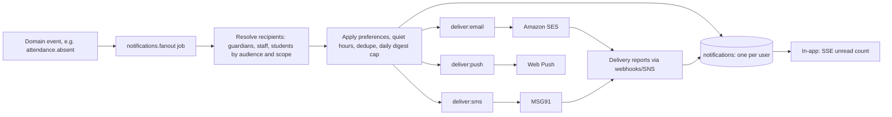
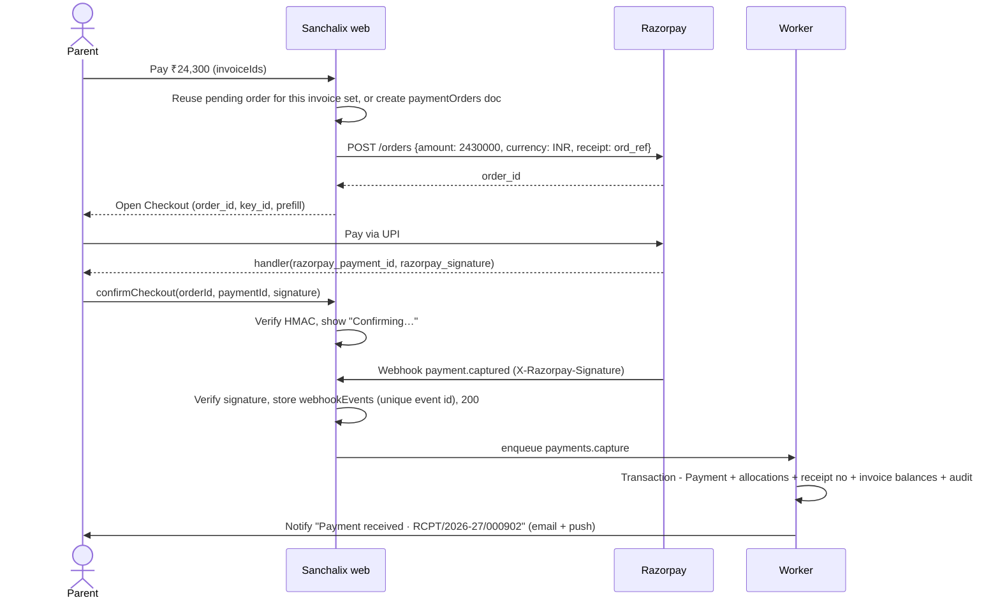

# 21 · Notifications and Integrations

How Sanchalix delivers notifications (in-app, email, SMS, web push, and WhatsApp in v2), and how it integrates with payment gateways, devices and other external systems. Templates and wording: [12-content-and-microcopy.md](12-content-and-microcopy.md#notification-and-sms-templates). Data: [14-data-model.md](14-data-model.md#notifications). Endpoints: [15-api-spec.md](15-api-spec.md). Operations: [20-devops-and-deployment.md](20-devops-and-deployment.md).

## Notification pipeline



1. The domain service emits an event by enqueueing `notifications.fanout` with `{ schoolId, templateKey, params, audience, dedupeKey, notBefore? }`.
2. **Recipient resolution** respects scope: the guardians of the absent student, the teachers of the section, the users with a role.
3. **Policy:**
   - **Category preferences** per user and channel (`guardians.notificationPrefs` or user prefs). In-app can't be switched off, because it's the record.
   - **Quiet hours** (`School.settings.quietHours`, default 21:00–07:00): SMS and push are held until the end of quiet hours. Emergency broadcasts and transport notices inside `transportWindows` are exempt.
   - **Dedupe:** `dedupeKey` (e.g. `absent:{studentId}:{date}`) is a unique index, so retries never double-send.
   - **Digest cap:** parents get at most 3 non-urgent push notifications a day. Extra items are folded into a 19:00 digest ("3 new updates for Kabir").
   - **Fee reminders:** at most one per guardian per 72 h.
4. The in-app `notifications` document is written first. Channel deliveries are queued, and each delivery's status is recorded in `deliveries[]`.
5. Failures retry with exponential backoff (5 attempts), then fall back: failed push → SMS for `urgent` categories (absence, emergency, payment failure); failed SMS → email if an email exists.

**Announcements by email and text (built 2026-10-21).** The author chooses Email and/or Text message when publishing; people get a copy unless they switched that channel off in Profile (`User.notificationPrefs`). Texts wait out quiet hours. Both channels use the `dev` provider until the SES and MSG91 keys are set. Web push is not built: it needs the installable PWA (v1) and VAPID keys.

## Channel matrix

Defaults per category. ✓ = on by default, ○ = available but off by default, — = not offered. Users change these in Profile → Notifications. Schools can turn channels off per category (e.g. no SMS for homework, to save credits).

| Category | Examples | In-app | Push | SMS | Email | Urgent |
|---|---|---|---|---|---|---|
| `attendance` | Absent today, late arrival | ✓ | ✓ | ✓ | ○ | yes |
| `fees` | Invoice issued, due soon, overdue, payment received, payment failed | ✓ | ✓ | ✓ (due, overdue) | ✓ (receipts) | payment failed |
| `exams` | Exam timetable published, results published | ✓ | ✓ | ○ | ✓ | no |
| `homework` | New homework, due tomorrow, evaluated | ✓ | ✓ | — | ○ | no |
| `announcements` | By author choice per announcement | ✓ | per announcement | per announcement | per announcement | emergency only |
| `messages` | New message | ✓ | ✓ | — | ○ | no |
| `transport` | Delay, route change, (v2) bus approaching | ✓ | ✓ | ✓ | — | yes (delays) |
| `library` | Due tomorrow, overdue | ✓ | ✓ | — | ○ | no |
| `approvals` (staff) | Leave, refund, scholarship awaiting you | ✓ | ✓ | — | ✓ (daily summary) | no |
| `system` | Import done, export ready, security alert (new sign-in) | ✓ | ○ | — | ✓ (security) | security |

## Channels

### In-app
- The `notifications` collection. The unread count is pushed via SSE (`/api/v1/events`) using Redis pub/sub. The drawer shows the latest 20; `/notifications` shows all with filters.
- Each notification has a `link` deep link ([07-information-architecture.md](07-information-architecture.md#notification-deep-links)).

### Email (Amazon SES)
- The sender domain `mail.sanchalix.app` with SPF, DKIM and DMARC (`p=quarantine`). Per-school custom domains are optional in v2.
- Templates are React Email components rendered in the worker, localised, with a plain-text alternative. Receipts and report cards are attached as PDFs, or linked if over 5 MB.
- Bounces and complaints come via SNS → `/api/webhooks/ses`. A hard bounce marks the email unverified and shows a banner to the user and school admin: "Emails to s.mehta@… are bouncing. Update the address."
- Rate: within the SES account send rate, and a worker concurrency limit per the SES quota.

### SMS (MSG91)
- India requires **DLT registration**: the principal entity ID, the sender ID (header `VIDYWN`, or the school's own header in v1), and each template registered verbatim with `{#var#}` placeholders. Template files store `dltTemplateId` alongside the text, and the rendered text **must** match the registered template exactly (checked by a test).
- Transactional route only. Unicode for Hindi (70 characters per part).
- Delivery reports via `/api/webhooks/msg91` update `deliveries[].status`.
- SMS credits: each school has a monthly allowance and top-ups. The composer shows the estimated cost before sending ([10-screen-specs.md](10-screen-specs.md#s27--announcement-composer)). The Super Admin dashboard shows the balance per school, with an alert at 10% remaining.
- Failover: if the MSG91 error rate is > 20% for 5 min, urgent categories fall back to push + email, and a P2 alert fires.

### Web push
- VAPID keys; subscriptions in `pushSubscriptions` per device. The payload is minimal: `{ title, body, link, tag }`, with no sensitive detail. "Kabir was marked absent today" is allowed, but marks and amounts are not included; the notification links into the app.
- iOS: the PWA must be installed (iOS 16.4+). The parent home shows install guidance on iOS.
- `410 Gone` responses remove the subscription.

### WhatsApp Business (v2)
- Via the Meta Cloud API through a BSP. Only pre-approved utility templates (absence, fee due, receipt, results).
- Opt-in is explicit per guardian (a DPDP consent purpose). It replaces SMS for opted-in guardians to reduce cost.

## Payment gateways

A `PaymentGateway` interface in `src/server/payments/` has two implementations, `razorpay.ts` and `stripe.ts` (v2). The school's gateway is chosen by `School.integrations`.

```ts
type PaymentGateway = {
  createOrder(input: { amountMinor: number; currency: string; receiptRef: string; notes: Record<string, string> }): Promise<{ orderId: string; clientPayload: unknown }>;
  verifyClientSignature(input: { orderId: string; paymentId: string; signature: string }): boolean;
  verifyWebhook(rawBody: string, headers: Headers): { event: GatewayEvent } | null;
  refund(input: { paymentId: string; amountMinor: number; reason: string }): Promise<{ refundId: string }>;
  fetchSettlements(date: DateStr): Promise<Settlement[]>;
};
```

### Razorpay flow



- **Source of truth:** the webhook (`payment.captured`, `payment.failed`, `refund.processed`, `order.paid`). The client confirmation only improves the UX.
- **Idempotency:** `webhookEvents` has a unique `eventId`; `payments.gateway.paymentId` is unique; an amount mismatch against the order is quarantined for manual review.
- **Invoice set changes:** if an invoice was paid at the counter while a checkout was open, the capture creates a payment with the unallocated remainder as an **advance credit**, flagged to the accountant. Money is never silently lost.
- **Reconciliation:** a daily job fetches the settlements, matches them to payments, and flags mismatches in `/fees/reconciliation`.
- **Refunds:** approved refunds call `refund()` and track `refund.processed`; the receipt stays unchanged, and the refund is listed on it.
- **Per-school accounts:** schools with their own Razorpay account (the money settles directly to the school) store encrypted keys in `School.integrations.razorpay`. Otherwise the platform account uses Razorpay Route to transfer to the school's linked account.

### Stripe (v2, international schools)
The same interface: Payment Intents + Checkout Sessions, and `checkout.session.completed` / `payment_intent.succeeded` webhooks with `Stripe-Signature` verification (5 min tolerance).

## Webhooks (inbound)

| Endpoint | Source | Verification | Processing |
|---|---|---|---|
| `/api/webhooks/razorpay` | Razorpay | HMAC-SHA256 of the raw body with the webhook secret, constant-time compare | Store the event → `200` → the worker processes it |
| `/api/webhooks/stripe` | Stripe | `Stripe-Signature` with timestamp tolerance | Same |
| `/api/webhooks/msg91` | MSG91 DLR | A shared-secret header + IP allow-list | Update the delivery status |
| `/api/webhooks/ses` | SNS (bounces, complaints) | SNS message signature verification | Mark the email status |

Rules: read the **raw body** (the route handler uses `await req.text()` before parsing); respond `200` fast after storing; never process inline; replays are safe; unknown event types are stored and ignored.

## Outbound integrations

| Integration | Purpose | Release |
|---|---|---|
| Tally / Zoho Books export | A daily or monthly CSV of fee receipts and payroll vouchers in their import formats | v1 |
| Bank payroll file | CSV/TXT per bank format (HDFC, ICICI, SBI templates) | v1 |
| iCal feed | A per-user tokenised `.ics` of events, exams, PTM and holidays | v1 |
| Open Library | ISBN lookup to pre-fill the catalogue | v1 |
| Google Workspace | Staff sign-in; optional Google Meet links for online PTM | MVP / v1 |
| Claude API | Narrative summaries and remark drafts, opt-in, no PII ([16-auth-and-security.md](16-auth-and-security.md#ai-and-privacy-v2)) | v2 |
| UDISE+ / board exports | Annual school statistics and board registration exports in the required formats | v2 |

Outbound webhooks for third parties (school-built integrations) are a v2 "Could": signed with `X-Sanchalix-Signature` (HMAC-SHA256), retried with backoff for 24 h, events `student.enrolled`, `payment.captured`, `attendance.submitted`.

## Biometric and QR attendance

| Mode | How it works | Release |
|---|---|---|
| **QR (staff self check-in)** | The branch displays a rotating QR (a 30 s TOTP-style token) on the office screen; staff scan it with the PWA → `checkIn({ method: 'qr', qrToken })`. Proof of presence without hardware | MVP |
| **QR (student)** | The student ID card QR encodes an opaque signed token (not the admission number). The teacher's phone scans cards in "Scan mode" on the Take attendance screen, marking them present | v2 |
| **QR kiosk** | A tablet at the gate in kiosk mode scans student cards; each event is posted to `/api/v1/devices/attendance` | v2 |
| **Biometric devices** | Devices (ZKTeco and eSSL via their push SDKs, or a small on-prem bridge) post events to `/api/v1/devices/attendance` with a device key. Each event maps the device user ID → Staff or Student via `attendanceDevices` mappings. The first punch of the day is check-in, the last is check-out. Duplicates are ignored by `deviceEventId` | v2 |

Device events **suggest** attendance: for students, they pre-fill the teacher's Take attendance screen (source `biometric`), and the teacher still submits. This keeps a human accountable and handles devices that are down. For staff, the events are the record.

## GPS tracking (v2)

- GPS devices or the driver's phone (a PWA "Driver mode" with background location on Android) post to `/api/v1/devices/gps` every 10 s while a trip is active.
- `vehiclePings` is a time-series collection with a 7-day TTL. The live view uses the latest ping (cached in Redis).
- Parents see their child's route only, during trip windows only. The ETA to their stop is computed from the remaining stops and the average speed.
- "Bus approaching" push fires when the ETA is ≤ 5 minutes (at most once per trip per stop).
